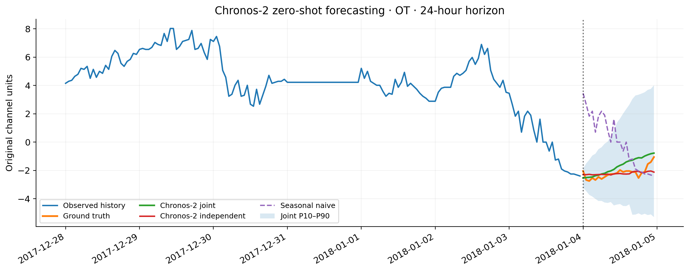
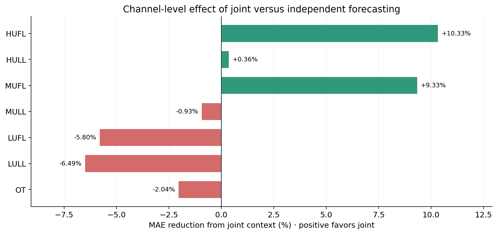
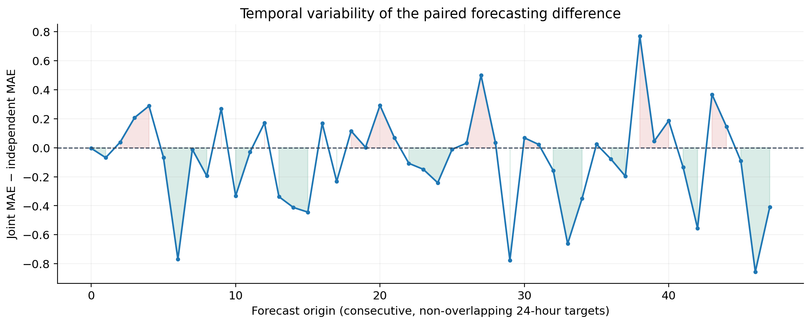

# Chronos-2: Zero-Shot Forecasting of Multivariate Sensor Data

**A reproducible technical case study of a time-series foundation model**  
Estela Sánchez-Carballo · November 2026

This project evaluates [Chronos-2](https://github.com/amazon-science/chronos-forecasting) on the seven-channel hourly [ETTh1](https://huggingface.co/datasets/thuml/Time-Series-Library) dataset. It compares zero-shot forecasts with simple baselines and studies whether joint multivariate inference is more accurate than forecasting each channel independently.

The emphasis is on **controlled experimental design, reproducibility, channel-level analysis and critical interpretation**, rather than model training or claiming a universally superior forecasting approach.

## Research questions

1. **Forecast accuracy:** How does a pretrained time-series foundation model perform against persistence and seasonal-naive forecasts?
2. **Cross-channel context:** Does passing all seven channels together improve performance relative to independent single-channel inference?
3. **Stability and uncertainty:** How do results vary across channels and forecast origins, and what is the empirical coverage of P10–P90 prediction intervals?

## Experimental design

| Setting | Value |
|---|---|
| Dataset | ETTh1, seven hourly channels |
| Model | `amazon/chronos-2` (`chronos-forecasting==2.3.2`) |
| Adaptation | None; pretrained weights, no task-specific fine-tuning |
| Forecast context | 168 hours |
| Forecast horizon | 24 hours |
| Test sample | 48 consecutive daily forecast origins with non-overlapping 24-hour targets |
| Target dates | 2018-01-04 00:00 to 2018-02-20 23:00 |
| Split | Within the conventional ETTh1 test partition from Time-Series-Library; **not** the full test partition |
| Evaluation | Per-channel MAE and RMSE; equal-weight macro-averages across channels; P10–P90 empirical coverage |

Each forecast uses only observations preceding its forecast origin. The **same target windows** are used for every method. The two Chronos-2 configurations use identical pretrained weights, forecast horizons and dates:

- **Joint:** one multivariate input of shape `[7, 168]` per origin.
- **Independent:** seven separate univariate inputs of shape `[168]` per origin.

The code sets `cross_learning=False` to prevent sharing information **between separate tasks**; the joint multivariate input can still model interactions among its channels.

## Main results

Results from the 48-origin evaluation (macro-average of channel-level metrics; **lower is better**):

| Method | Macro MAE ↓ | Macro RMSE ↓ |
|---|---:|---:|
| Persistence | 1.972 | 3.212 |
| Seasonal naive | 1.313 | 2.115 |
| **Chronos-2 joint** | **1.275** | **2.108** |
| Chronos-2 independent | 1.356 | 2.257 |

Under this specific protocol, joint inference reduced macro MAE by **5.92% relative to independent inference** and by approximately **2.9% relative to seasonal naive**. The joint configuration had lower MAE on **3 of 7 channels**, so the macro improvement does **not** imply a universal channel-level advantage. Paired per-origin errors also vary over time.

### Visual results

**Illustrative forecast**



**Channel-level effect of joint context**



**Temporal variation in paired errors**



## Repository contents

```text
.
├── Chronos2_Technical_Case_Study.ipynb  # Full executable analysis and generated report
├── requirements.txt                    # Python dependencies
├── tested_environment.txt              # Versions observed in the Colab run
├── figures/
│   ├── forecast_example.png
│   ├── joint_context_by_channel.png
│   └── temporal_paired_mae_difference.png
└── README.md
```

When executed, the notebook also creates `chronos2_results_final/` containing CSV metrics, figures, `results.json` and `experiment_report.md`. These files are generated artifacts, not prerequisites for running the notebook.

## Installation and execution

**Prerequisites:** Python 3.11 is a tested local version; internet access is required the first time to download ETTh1 and the public Chronos-2 model weights. GPU support is optional.

Clone/download this repository, open a terminal **in its root directory**, and create a clean Python environment.

**Windows (PowerShell):**

```powershell
py -3.11 -m venv .venv
.\.venv\Scripts\Activate.ps1
python -m pip install --upgrade pip
python -m pip install -r requirements.txt
python -m pip install ipykernel
```

**macOS / Linux:**

```bash
python3.11 -m venv .venv
source .venv/bin/activate
python -m pip install --upgrade pip
python -m pip install -r requirements.txt
python -m pip install ipykernel
```

Open `Chronos2_Technical_Case_Study.ipynb` in VS Code or Jupyter and select the newly created `.venv` environment as its kernel. Run the analysis cells in order.

The notebook includes an **optional** `%pip install -q -r requirements.txt` cell for notebook-first environments. **Skip this cell if you have already installed dependencies in the active virtual environment.** Its relative path assumes that the notebook's working directory is the repository root. This is not automatically guaranteed if opening an individual notebook from Google Colab/Drive; use an appropriate working directory or install dependencies in that environment separately.

To check dependency consistency:

```bash
python -m pip check
```

**PyTorch:** The `requirements.txt` uses a portable PyTorch version constraint rather than a CUDA-specific wheel. PyTorch may install as a CPU build; GPU-specific installations should follow the [official PyTorch instructions](https://pytorch.org/get-started/locally/) for the target platform.

## Reproducibility notes

- The model is **not trained or fine-tuned** in this notebook. “Zero-shot” refers to the absence of task-specific adaptation in this experiment; ETTh1's possible inclusion in upstream pretraining data has **not** been ruled out.
- The 48 test origins are **one contiguous time period**, not 48 statistically independent domains. The seven channels are combined in their original numerical units when computing macro metrics.
- MAE and RMSE are first computed **per channel** over the evaluated targets, then averaged across channels. Macro RMSE is **not** the pooled RMSE over all observations.
- Empirical interval coverage is descriptive, not proof of calibration on unseen datasets. Joint-vs-independent differences do not establish causal dependencies among channels.
- Inference times are diagnostics, **not** controlled latency benchmarks.
- The notebook was run successfully on Google Colab with CUDA and separately on **Windows / Python 3.11 / CPU** using a fresh environment installed from `requirements.txt`; the reported metrics agreed at three decimal places. See `tested_environment.txt` for the recorded Colab package versions.

## Sources

- [Amazon Chronos / Chronos-2 documentation and implementation](https://github.com/amazon-science/chronos-forecasting)
- [ETTh1 dataset (THUML Time-Series-Library)](https://huggingface.co/datasets/thuml/Time-Series-Library)
- [Time-Series-Library `Dataset_ETT_hour` loader](https://github.com/thuml/Time-Series-Library/blob/main/data_provider/data_loader.py)

This is an **independent technical case study**, not an official benchmark result from the model authors or an assessment of production deployment readiness.
